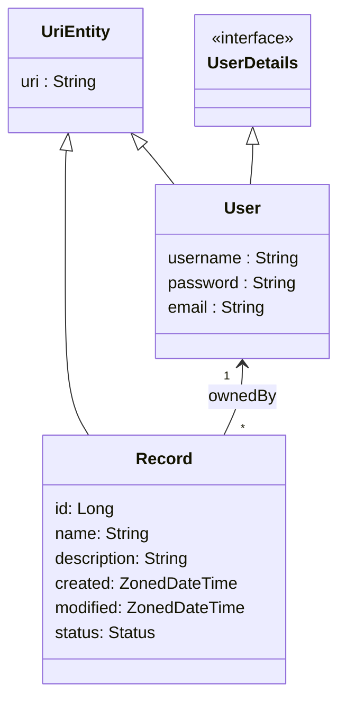

# FrivLegion

FrivLegion is a centralized web platform for casual minigames. Additional details: [HELP.md](HELP.md)

## Vision

**For** casual players
**who** want a single place to discover and play quick minigames
**the project** is a centralized web platform for casual minigames
**that** provides user accounts with authentication and ownership-based access control over platform data
**Unlike** scattered standalone game sites, FrivLegion unifies many minigames under one account-driven platform

## Features per Stakeholder

| USER                          | ADMIN                |
|-------------------------------|----------------------|
| Register                      |                      |
| Login                         |                      |
| Create Record                 |                      |
| Retrieve Record               |                      |
| Update Record                 |                      |
| Delete Record                 |                      |

## Entities Model

## AI-Assisted Spec-Driven Development (SDD)

This repository serves as a starter template for **AI-Assisted Spec-Driven Development (SDD)** with **Spring Data REST** and **Cucumber BDD**.

It is pre-configured with agent skills (`skills/`), repository instructions (`AGENTS.md`, `CONVENTIONS.md`), and Aider configuration (`.aider.conf.yml`) to support both:
1. **Full-Capability AI Agents** (OpenCode, Claude Code, Cursor, GitHub Copilot, Windsurf).
2. **Token-Constrained APIs** (Aider paired with Groq free tier - 8K token limits).

For complete stage-by-stage instructions and command workflows, see **[AI_DEVELOPMENT_GUIDE.md](AI_DEVELOPMENT_GUIDE.md)**.

### SDD Agent Skills (`skills/`)
- **`skills/sdd-feature-designer/SKILL.md`**: Draft Cucumber `.feature` specs for Spring Data REST endpoints (<50 lines).
- **`skills/sdd-cucumber-steps/SKILL.md`**: Implement MockMvc step definition classes extending `StepDefs.java`.
- **`skills/spring-datarest-entity/SKILL.md`**: Create JPA `@Entity` classes extending `UriEntity` and `@RepositoryRestResource` interfaces with SpEL row-level security queries.
- **`skills/spring-datarest-hander/SKILL.md`**: Create lifecycle event handlers based on the `@RepositoryEventHandler`.
- **`skills/sdd-bdd-verifier/SKILL.md`**: Run `mvn test -Dtest=CucumberTest` and analyze test failure summaries. 

## Deployment

### Render

The web application is containerized (Docker) and can be deployed on [Render](https://render.com) using the [`render.yaml`](render.yaml) infrastructure-as-code file at the repository root.

The service is connected to a **Neon** PostgreSQL database through the `DATABASE_URL` environment variable.

**Required environment variables:**

| Variable | Required | Description |
|----------|----------|-------------|
| `DATABASE_URL` | Yes | Neon PostgreSQL connection string (e.g. `postgresql://<user>:<password>@<host>/<database>`). |
| `SPRING_PROFILES_ACTIVE` | Yes | `postgres` (activates the datasource that reads the `DATABASE_URL` env var). |
| `DEFAULT_PASSWORD` | No | Default password for the seeded player (default: `password`). |
| `PORT` | No | Port the server listens on (default: `8080`). |

**Initial database setup:** Flyway automatically applies the initial schema from `src/main/resources/db/migration/V1__Initial_schema.sql` against the Neon database on application startup.

**Deploy steps:**
1. Create a Neon PostgreSQL database.
2. Create a new web service on Render from the `render.yaml` blueprint (or manually create a Docker web service).
3. Set the `frivlegion_neon_database_url` secret with the Neon connection string.
4. Deploy the service.

### Fly.io

The current production deployment target is [Fly.io](https://fly.io) via the [`fly.toml`](fly.toml) file, deploying the Docker container to `frivlegion.fly.dev`.

